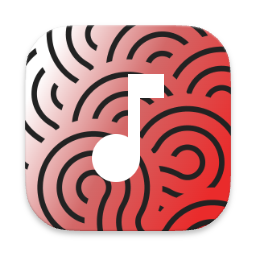
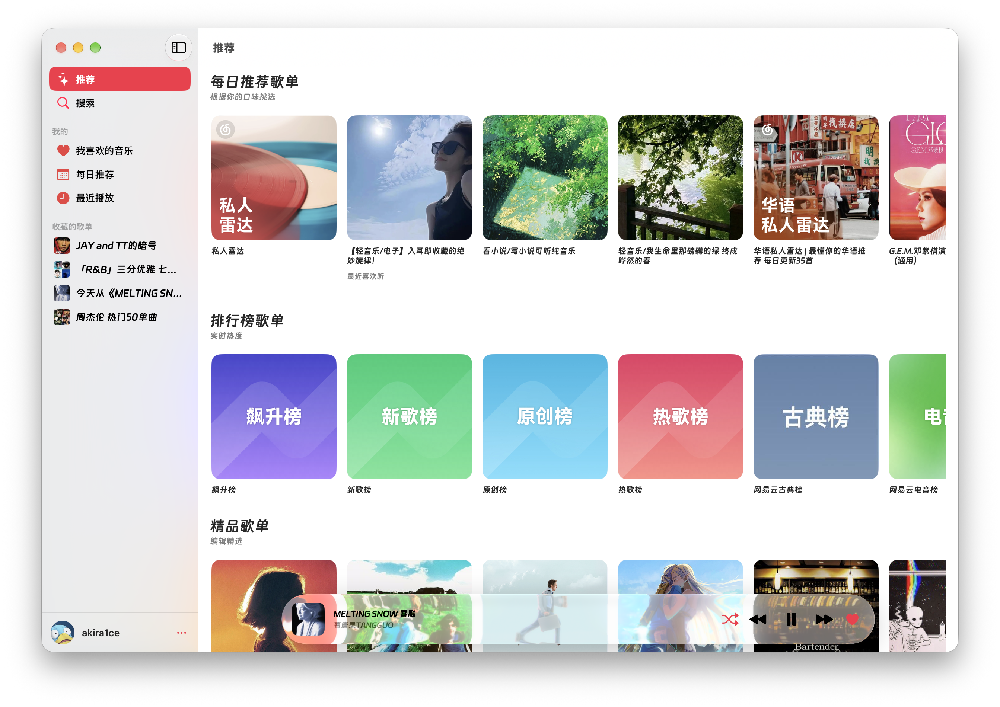
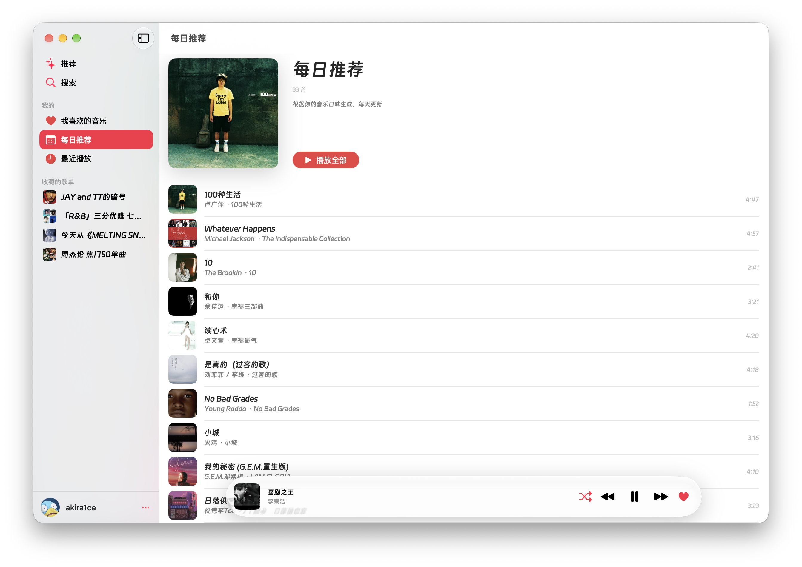
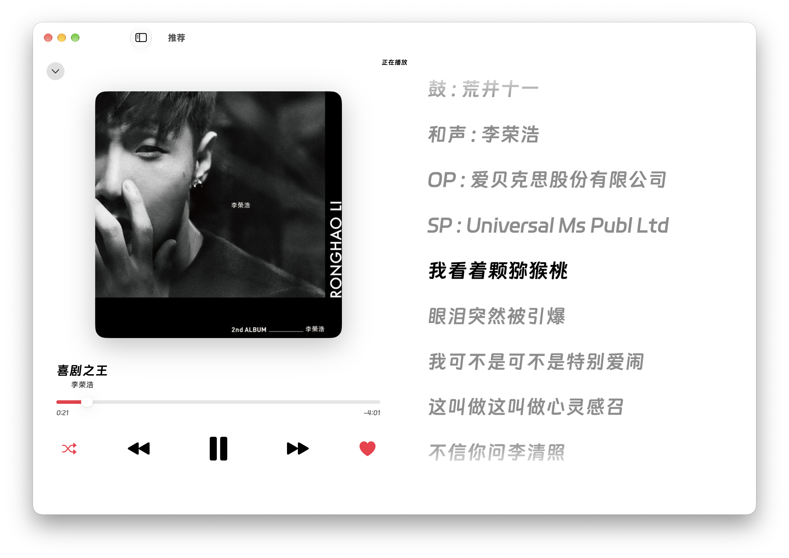
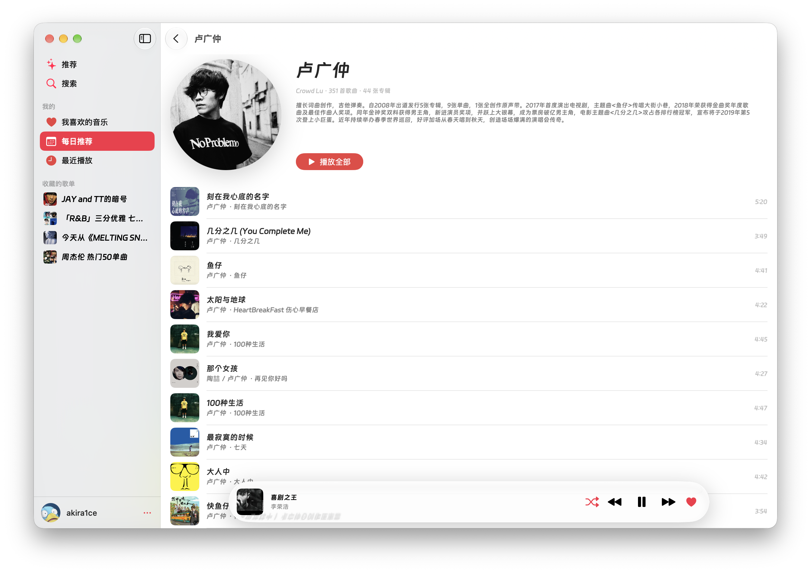

> [!IMPORTANT]
> Sonaro is an unofficial, independently developed client and is not affiliated with NetEase Cloud Music.
> The project contains no music content or account data and is intended for learning and personal use only, not for commercial purposes.
> All music copyrights belong to NetEase Cloud Music and the respective rights holders.

<div align="right">

**English** | [简体中文](README_CN.md)

</div>

<div align="center">



# Sonaro

**Listen to your world — a native SwiftUI NetEase Cloud Music client for macOS**

SwiftUI · AVPlayer · NeteaseCloudMusicApiEnhanced backend

[](#build--run)
[](#build--run)
[](#features)

<table>
  <tr>
    <td></td>
    <td></td>
  </tr>
  <tr>
    <td></td>
    <td></td>
  </tr>
</table>

</div>

## Features

- 🔐 **QR code login** — scan with the NetEase Cloud Music app; the cookie is stored in the macOS Keychain. On cold launch the cached session renders immediately while validation runs in the background, so a network hiccup never signs you out
- 🏠 **Recommendations** — daily playlists, charts, editor-picked playlists, and popular artists across four horizontal shelves, with skeleton loading and page-level retry
- 📅 **Daily Recommendations** — a fresh set of tracks every day, with a cover header, Play All, and the track list
- 🕘 **Recently Played** — switch the play history between Last week and All time
- 🔍 **Search** — song search with 600 ms debounce, duplicate submission suppression, skeletons, infinite scrolling, and empty/error states
- 💿 **Playlists & Artists** — playlist details (creator, description, play count, update time, Play All, subscribe/unsubscribe); artist pages (circular portrait, bio, hot tracks). Artist names in track rows link straight to the artist page
- ❤️ **Likes** — hover actions in track lists and a heart in the player; optimistic updates roll back automatically if the request fails
- 🎧 **Playback** — AVPlayer queue; sequential, repeat-one, shuffle, and repeat-all modes; five quality levels (Standard, Higher, Ex-High, Lossless, Hi-Res) applied to the next track; loading and failure states are visible
- 🪟 **Mini player** — a glass capsule docked at the bottom of the window; click to open Now Playing
- 🖼 **Now Playing** — large artwork that scales with playback; cover and transport controls on the left, synced lyrics on the right. Automatically switches to a compact lyrics-plus-controls layout when the window is narrow
- 📝 **Synced lyrics** — line-by-line highlighting and auto-follow; click a line to seek. Manual scrolling pauses following, and the view returns to the current line after 2.5 seconds; edges fade out
- ⌨️ **System integration** — lock screen, Control Center, and media keys (play, pause, previous, next, seek); Space toggles playback
- 🎨 **Appearance & fonts** — light, dark, or system; custom font family and four size presets with a live preview in Settings
- 🗄️ **Cache** — covers in a disk-backed `URLCache` (about 256 MB), lyrics persisted per song ID; Settings shows usage and offers one-click clearing
- 🧪 **Unit tests** — pure-logic coverage for LRC parsing, playback mode cycling, tolerant model decoding, formatting, and search paging

## Build & Run

Requires **macOS 26+** and **Xcode 26+** (Swift 5).

```bash
open Sonaro.xcodeproj
```

Choose the **Sonaro** scheme and **My Mac**, then press ⌘R. The project uses synchronized folder groups, so new source files on disk join the target automatically.

> [`APIConfig.swift`](Sonaro/Core/Networking/APIConfig.swift) is git-ignored so every environment keeps its own backend address. After cloning, create it from [`APIConfig.swift.template`](Sonaro/Core/Networking/APIConfig.swift.template):
>
> ```bash
> cp Sonaro/Core/Networking/APIConfig.swift.template Sonaro/Core/Networking/APIConfig.swift
> ```
>
> Then set `baseURL` to your NeteaseCloudMusicApiEnhanced instance.

### Command-line build and tests

```bash
# Build (same command as CI)
xcodebuild -scheme Sonaro -destination 'platform=macOS' build

# Run unit tests
xcodebuild test -scheme Sonaro -destination 'platform=macOS'
```

`.github/workflows/ci.yml` runs the build and tests on every push / PR.

### Packaging a DMG

```bash
brew install create-dmg
./build-dmg.sh
# Output: dist/Sonaro-<version>.dmg
```

Builds a universal Release app and packages it with a drag-to-install layout. The artifact is unsigned; on first launch, right-click the icon and choose **Open**.

## Backend & Configuration

Sonaro relies on a third-party, unofficial [NeteaseCloudMusicApiEnhanced](https://github.com/neteasecloudmusicapienhanced/api-enhanced) service (not affiliated with NetEase Cloud Music):

- The API address is a built-in constant in [`APIConfig.swift`](Sonaro/Core/Networking/APIConfig.swift), which is git-ignored. Create it from [`APIConfig.swift.template`](Sonaro/Core/Networking/APIConfig.swift.template) (see [Build & Run](#build--run)), change `baseURL` to your own instance, and rebuild; there is no in-app server setting.
- Plain HTTP is allowed through an ATS exception (`NSAllowsArbitraryLoads`); HTTPS instances work as well.
- The login cookie is sent as a query parameter with each request. A 301 response means the session has expired; if that happens during cold-launch validation, the app returns to the QR login screen.
- A local device ID is stored in a separate Keychain item and survives logout. Anonymous QR requests carry only this identity; authenticated requests merge the account cookie with the same `deviceId`. The backend must honor `cookie.deviceId`.
- See [`api-doc.md`](api-doc.md) for the full API reference.

> The login cookie is sent to whichever backend you configure. The default address is for demonstration only — use your own deployment over HTTPS and never connect to an untrusted server.

## Architecture

Five `@MainActor` `ObservableObject` managers are created in [`SonaroApp.swift`](Sonaro/SonaroApp.swift) and injected with `.environmentObject`. They own all session, networking, and playback state; screens never maintain their own:

- `AuthManager` — session state machine (`.unknown → .loggedOut/.loggedIn`) and QR login polling
- `PlayerManager` — AVPlayer queue, playback controls, lyric sync, and system Now Playing; high-frequency progress lives in `PlaybackProgress` / `LyricPlaybackState` so list screens don't redraw every second
- `AppearanceManager` — dark / light / system
- `FontManager` — global font family and size
- `LikeManager` — the liked-song ID set with optimistic updates and rollback

`RootView` switches on `auth.state` (splash → QR login → `MainShell`). `MainShell` uses a `NavigationSplitView` sidebar; the mini player and Now Playing live at window level, so they stay visible after drilling into a playlist.

```
Sonaro/
├─ SonaroApp.swift          # @main; creates and injects shared state
├─ App/                     # RootView, MainShell, Theme, AppearanceManager, FontModifier
├─ Core/
│  ├─ Networking/           # APIConfig (built-in URL), APIClient (async + cookie), APIError
│  ├─ Models/               # Song / Album / Artist / Playlist / Profile (tolerant decoding)
│  ├─ Services/             # MusicService (one method per endpoint), LyricParser, LyricsCache
│  ├─ Auth/                 # AuthManager, Keychain, SessionStore
│  ├─ Player/               # PlayerManager, LyricSynchronizer, NowPlayingController
│  ├─ Library/              # LikeManager
│  └─ Utils/                # ImageLoader, platform helpers, formatters
└─ Features/                # Login, Recommend, Daily, Search, Recent, Home,
                            # Artist, Player, Settings, Sidebar, Components
```

## Disclaimer

- This is a personal learning and technical exchange project, not an official NetEase Cloud Music product, and has no affiliation or partnership with NetEase Cloud Music.
- The project does not provide or distribute any music resources. Songs, covers, lyrics, and other content are returned by the third-party API service configured by the user.
- You need your own NetEase Cloud Music account. Please comply with NetEase Cloud Music's user agreement; any account or usage risk is borne by the user.
- The default backend is for demonstration only. Self-hosting NeteaseCloudMusicApiEnhanced over HTTPS is recommended; the availability, security, and data handling of third-party services are not the responsibility of this project.
- This project is for personal learning and research only and must not be used commercially or for any copyright-infringing activity.

## Credits

- [NeteaseCloudMusicApiEnhanced](https://github.com/neteasecloudmusicapienhanced/api-enhanced) — all data endpoints
- UI and interactions are inspired by Apple Music; only design ideas were referenced, no assets were used.
