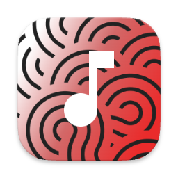
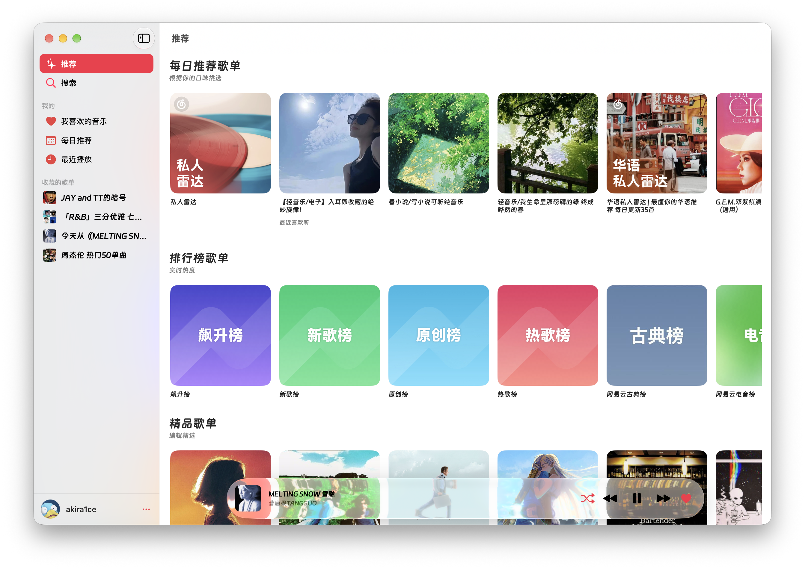
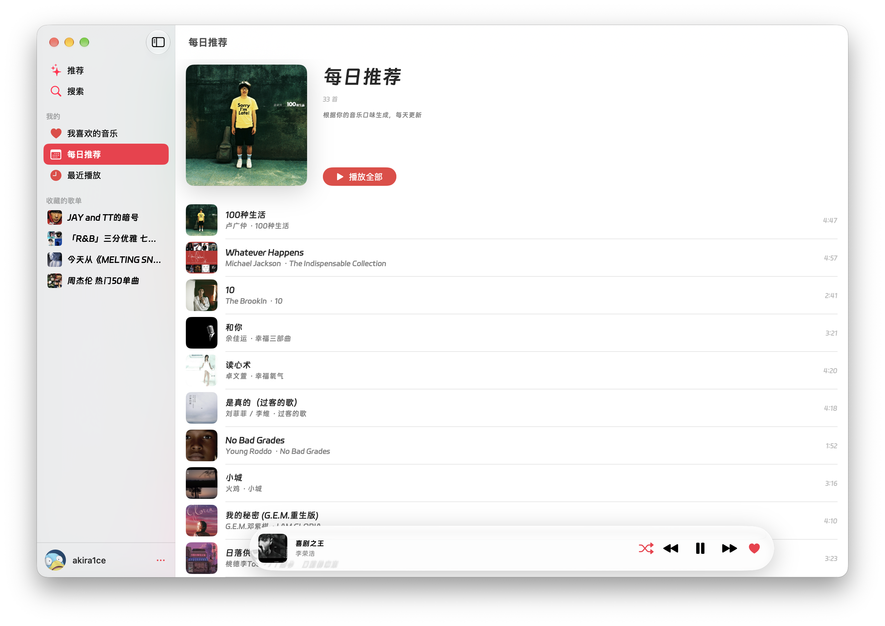
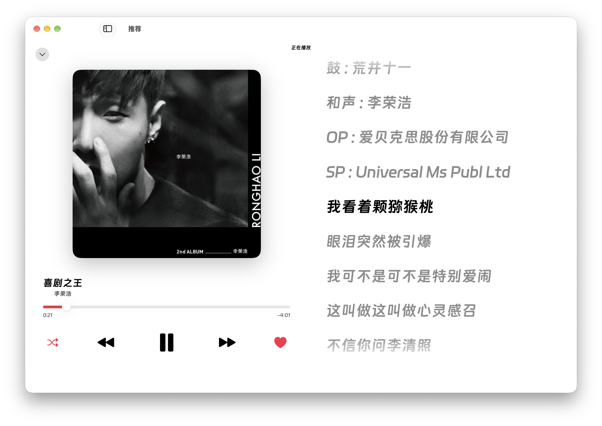
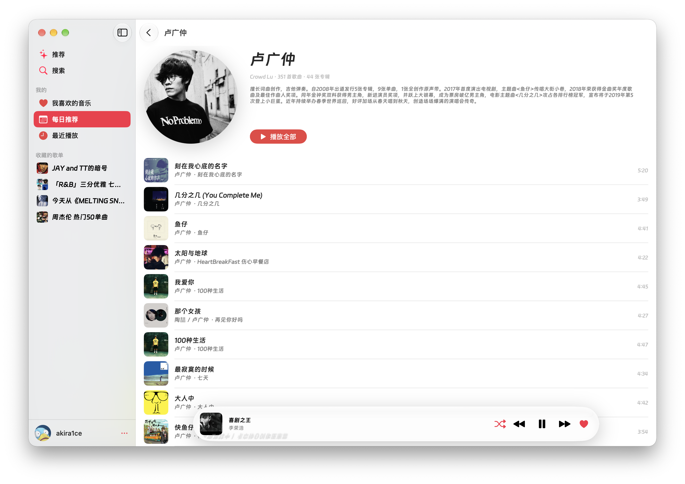

> [!IMPORTANT]
> Sonaro 是个人开发的非官方音乐客户端，与所接入的音乐服务无隶属或合作关系。
> 项目不包含任何音乐内容或账号数据，仅供学习与个人使用，请勿用于商业用途。
> 音乐内容及相关版权归各自权利人所有。

<div align="right">

[English](README.md) | **简体中文**

</div>

<div align="center">



# Sonaro

**聆听你的世界 — 原生 SwiftUI 的 macOS 音乐客户端**

SwiftUI · AVPlayer · 本机直连

[](#构建与运行)
[](#构建与运行)
[](#功能)

<table>
  <tr>
    <td></td>
    <td></td>
  </tr>
  <tr>
    <td></td>
    <td></td>
  </tr>
</table>

</div>

## 功能

- 🔐 **扫码登录** — 使用音乐服务的官方 App 扫码授权；cookie 保存在 Keychain，冷启动先用缓存会话立即渲染，再后台校验，网络波动不会让你掉登录
- 🏠 **推荐** — 每日推荐歌单、排行榜、精品歌单、热门歌手四个横向歌单区，带骨架屏与整页重试
- 📅 **每日推荐** — 每天更新的推荐歌曲，封面头部 + 播放全部 + 歌曲列表
- 🕘 **最近播放** — 播放记录支持「最近一周 / 所有时间」切换
- 🔍 **搜索** — 单曲搜索，600 ms 防抖、重复提交去重、骨架屏、滚动加载更多、空结果与失败状态
- 💿 **歌单与歌手** — 歌单详情（创建者、简介、播放量、更新时间、播放全部、收藏/取消收藏）；歌手主页（圆形头像、简介、热门歌曲）。歌曲行里的艺人名可直接点进歌手页
- ❤️ **喜欢** — 列表悬停快捷播放/喜欢，播放器内红心；乐观更新，请求失败自动回滚
- 🎧 **播放** — AVPlayer 队列；顺序 / 单曲循环 / 随机 / 列表循环四种模式；标准、较高、极高、无损、Hi-Res 五档音质（下一首生效）；加载与失败状态可见
- 🪟 **迷你播放器** — 悬浮在窗口底部的玻璃胶囊，点击展开全屏播放页
- 🖼 **全屏播放页** — 大封面随播放状态缩放，左侧封面与传输控制、右侧同步歌词；窗口过窄时自动切换为「歌词 + 控制栏」紧凑布局
- 📝 **同步歌词** — 逐行高亮与滚动跟随，点击歌词跳转进度；手动滚动时暂停跟随，2.5 秒后回到当前行；上下边缘渐隐
- ⌨️ **系统集成** — 锁屏 / 控制中心 / 媒体键（播放、暂停、上一首、下一首、拖动进度）；空格键播放/暂停
- 🎨 **外观与字体** — 深色 / 浅色 / 跟随系统；自定义字体族与四档字号，设置页实时预览
- 🗄️ **缓存** — 封面写入磁盘 `URLCache`（约 256 MB），歌词按歌曲 ID 落盘；设置页显示占用并可一键清除
- 🧪 **单元测试** — 覆盖 LRC 解析、播放模式切换、容错模型解码、格式化与搜索分页等纯逻辑

## 构建与运行

要求 **macOS 26+** 与 **Xcode 26+**（Swift 5）。

```bash
open Sonaro.xcodeproj
```

选择 **Sonaro** scheme 和 **My Mac**，⌘R 运行。工程使用 synchronized folder groups，磁盘上新增的源文件会自动进入 target。

无需部署或配置额外服务器，应用在本机完成请求处理并通过 HTTPS 连接音乐服务。

### 命令行构建与测试

```bash
# 构建（CI 同款命令）
xcodebuild -scheme Sonaro -destination 'platform=macOS' build

# 运行单元测试
xcodebuild test -scheme Sonaro -destination 'platform=macOS'
```

`.github/workflows/ci.yml` 会在 push / PR 时执行上述构建与测试。

### 打包 DMG

```bash
./build-dmg.sh
# 输出：dist/Sonaro-<版本号>.dmg
```

脚本构建 Universal Release 应用，并用 `hdiutil` 生成带“应用程序”快捷方式的 DMG（不需要 create-dmg，也不会弹出 Finder 窗口）。应用会用本机的 Apple Development 证书签名（需在 Xcode 中登录与 `DEVELOPMENT_TEAM` 对应的账号），因此重装后钥匙串权限仍然有效、不会每次安装都要求输入登录密码；签名绑定本机，拷贝到其他设备后首次打开需右键 → 打开。找不到签名证书时脚本会直接报错退出，不会退回 ad-hoc 签名。

## 连接与会话

应用直接连接音乐服务，无需额外服务器或运行环境。

- 二维码在本机生成，扫码授权后的登录凭据保存在 macOS Keychain。
- 账号凭据仅用于服务接口请求，不发送至音频 CDN；退出登录只清除本机会话。
- 本机设备标识单独保存，退出账号后仍保留。
- 接口适配为非官方实现，可能因服务变更或安全验证而暂时不可用。播放受账号权限、地区与版权限制，不以试听片段代替完整歌曲。
- 第三方来源与许可见 [THIRD_PARTY_NOTICES.md](THIRD_PARTY_NOTICES.md)。

## 架构

五个 `@MainActor` `ObservableObject` 在 [`SonaroApp.swift`](Sonaro/SonaroApp.swift) 中创建，并通过 `.environmentObject` 注入。所有会话、网络与播放状态都由它们持有，页面不自己维护：

- `AuthManager` — 会话状态机（`.unknown → .loggedOut/.loggedIn`）与扫码登录轮询
- `PlayerManager` — AVPlayer 队列、播放控制、歌词同步、系统 Now Playing；高频进度单独放在 `PlaybackProgress` / `LyricPlaybackState`，避免列表页每秒重绘
- `AppearanceManager` — 深色 / 浅色 / 跟随系统
- `FontManager` — 全局字体族与字号
- `LikeManager` — 喜欢的歌曲 ID 集合，负责乐观更新与失败回滚

`RootView` 根据 `auth.state` 切换（启动页 → 扫码登录 → `MainShell`）。`MainShell` 使用 `NavigationSplitView` 侧边栏；迷你播放器和全屏播放页挂在窗口层级，确保进入歌单详情后仍然可见。

```
Sonaro/
├─ SonaroApp.swift          # @main，创建并注入共享状态
├─ App/                     # RootView、MainShell、Theme、AppearanceManager、FontModifier
├─ Core/
│  ├─ Networking/           # APIConfig（内置地址）、APIClient（async + cookie）、APIError
│  ├─ Models/               # Song / Album / Artist / Playlist / Profile（容错解码）
│  ├─ Services/             # MusicService（每个接口一个方法）、LyricParser、LyricsCache
│  ├─ Auth/                 # AuthManager、Keychain、SessionStore
│  ├─ Player/               # PlayerManager、LyricSynchronizer、NowPlayingController
│  ├─ Library/              # LikeManager
│  └─ Utils/                # ImageLoader、平台辅助、格式化
└─ Features/                # Login、Recommend、Daily、Search、Recent、Home、
                            # Artist、Player、Settings、Sidebar、Components
```

## 免责声明

- 本项目为个人学习与技术交流项目，非官方产品，与所接入的音乐服务无隶属或合作关系。
- 项目不提供、不分发任何音乐资源；歌曲、封面、歌词等内容由所接入的音乐服务提供。
- 使用账号功能需要你自己的服务账号，请遵守相关服务的用户协议；账号及使用风险由使用者自行承担。
- 服务可用性及安全验证要求由服务方决定，本项目不保证接口长期兼容。
- 本项目仅供个人学习研究，不得用于商业用途或任何侵犯版权的行为。

## 致谢

- [接口适配参考](THIRD_PARTY_NOTICES.md) — 第三方来源与许可说明
- 界面与交互参考 Apple Music，仅借鉴设计思路，未使用其任何资源
